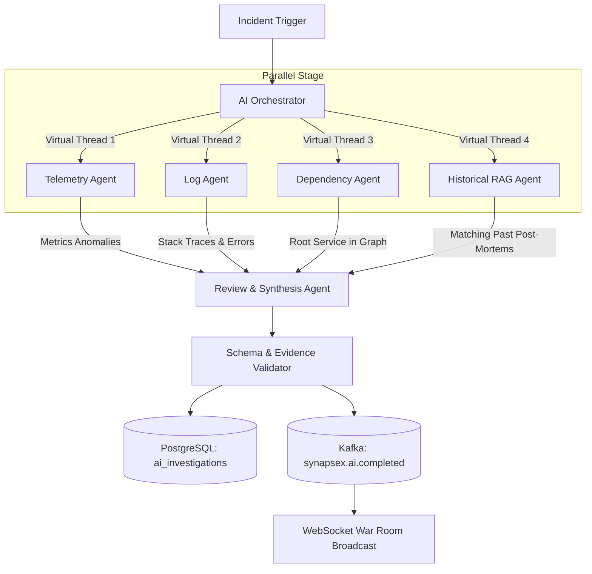

# SynapseX AI & Multi-Agent Architecture

## 1. Provider Abstraction & Safe Execution
SynapseX abstracts all LLM and vector embedding interactions behind two primary interfaces:
- `LlmProvider`:
  - `generateStructuredInvestigation(IncidentContext context): InvestigationResult`
  - `chatInWarRoom(WarRoomContext context): AiChatMessage`
- `EmbeddingProvider`:
  - `embed(String text): float[]`

### Provider Implementations:
1. **`SpringAiLlmProvider`**: Delegates to OpenAI / Anthropic / Ollama via Spring AI ChatClient. Enabled when `SYNAPSEX_AI_PROVIDER` and `API_KEY` are provided.
2. **`DemoProvider`**: Automatically active when external API credentials are absent. Executes deterministic heuristic analysis across the real collected incident telemetry, service dependencies, and error logs.
   - Strictly outputs `"mode": "DEMO"` in all JSON payloads.
   - Visibly flags output on UI: `"DEMO — not a real AI result"`.
   - Never fabricates fake evidence; all observations cite actual `eventId`s present in the database.

## 2. Multi-Agent Orchestration Workflow
On incident confirmation or manual trigger (`POST /api/incidents/{id}/investigate`), the Orchestrator executes 4 specialized subagents concurrently using Java 21 Virtual Threads (`Executors.newVirtualThreadPerTaskExecutor()`):

### Agent Responsibilities:
- **Telemetry Agent**: Examines metric time-series around incident onset (CPU, memory, latency, DB connections, consumer lag). Identifies sudden slope changes and metric correlations.
- **Log Agent**: Scans recent ERROR/FATAL logs, extracts unique stack traces, groups error patterns, and identifies culprit trace IDs.
- **Dependency Agent**: Traverses the upstream/downstream service graph to identify the earliest point of failure (root culprit vs cascading symptoms).
- **Historical (RAG) Agent**: Queries pgvector embeddings of past resolved incidents to retrieve high-similarity resolutions and mitigation actions.
- **Review Agent**: Synthesizes subagent findings, reconciles contradictions, assigns confidence scores (`LOW|MEDIUM|HIGH`), and generates structured hypotheses.

## 3. Strict Safety & Defense Against Prompt Injection
1. **Delimited Untrusted Context**: Logs, metric payloads, and user messages are treated as untrusted data and wrapped in non-executable delimiters (`<<<UNTRUSTED_DATA_START>>> ... <<<UNTRUSTED_DATA_END>>>`).
2. **Instruction Neutralization**: Pre-processing sanitizes known prompt-injection tokens ("ignore previous instructions", "system override", "you are now").
3. **Read-Only Tool Boundaries**: Agents have zero mutation capabilities. Available tools are strictly read-only within the tenant's workspace boundary. Sensitive mitigation actions (e.g. restart pod, rollback deployment) are rendered only as advisory recommendations requiring human engineer sign-off.
4. **Evidence Reference Verification**: Every observation must cite valid `eventId`s. The validator rejects or strips claims that cite non-existent event IDs.
5. **Insufficient Evidence Fallback**: When anomaly evidence does not meet minimum diagnostic confidence, the model outputs: `"Insufficient evidence to determine the root cause."`
