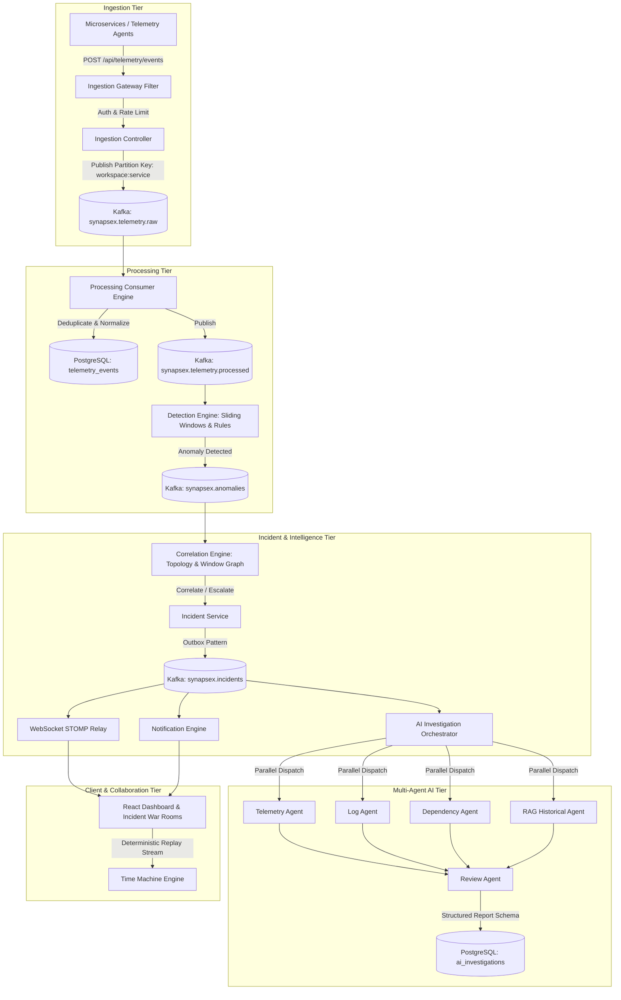

# SynapseX Architecture Specification

## 1. System Overview
SynapseX is an AI-powered real-time distributed incident intelligence platform. It ingests high-volume telemetry from distributed microservices, executes stream-based rule and statistical anomaly detection, correlates anomalies into unified incidents via topological dependency graphs and time-window clustering, orchestrates multi-agent AI root cause investigation, powers collaborative war rooms over WebSockets, and provides deterministic Time Machine replay with "What Changed?" analysis.

## 2. Component Boundaries & Responsibilities

### 2.1 Backend Modules (`com.synapsex`)
- **`auth`**: User registration, login, JWT issuance, refresh token rotation with reuse detection, BCrypt hashing, and Spring Security configuration.
- **`workspace`**: Multi-tenant workspace entities, memberships, role assignments (`ADMIN`, `ENGINEER`, `INCIDENT_MANAGER`, `VIEWER`), and tenancy context resolvers.
- **`ingestion`**: Secure high-throughput REST ingestion endpoints (`/events`, `/batch`), API key authorization, schema validation, rate-limiting filter, deduplication ledger, and Kafka raw producer.
- **`processing`**: Kafka consumer group for telemetry normalization, persistence, sliding-window aggregator, and anomaly detection engine (rule threshold + recovery detection).
- **`incident`**: Correlation engine analyzing service dependency graphs and temporal proximity, SEV1-SEV4 calculation, incident state machine (`DETECTED` -> `INVESTIGATING` -> `MITIGATING` -> `RESOLVED` -> `CLOSED`), timeline events, optimistic locking (`@Version`).
- **`collaboration`**: Real-time STOMP WebSocket endpoints (`/topic/incidents/{id}/war-room`), message persistence, monotonic room sequence numbers, read receipts, Redis presence heartbeats.
- **`ai`**: Provider abstraction (`LlmProvider`, `EmbeddingProvider`), `DemoProvider` heuristic engine, parallel multi-agent runner (virtual threads), strict JSON schema validator, prompt injection sanitizer.
- **`knowledge`**: Incident resolution embedding generator, `pgvector` HNSW store, multi-tenant scoped semantic search (`/api/knowledge/search`).
- **`replay`**: Deterministic event-stream builder for Time Machine, "What Changed?" baseline-vs-incident delta comparator.
- **`notification`**: In-app notifications, user preference matrix, WebSocket broadcast.
- **`simulation`**: Seedable failure scenario generator (8 canonical scenarios: CPU spike, memory leak, DB connection pool starvation, latency surge, Kafka lag, payment failure, cascade failure, network partition).
- **`common`**: RFC 7807 `ProblemDetail` handlers, audit logger, MDC filter (`traceId`, `workspaceId`).

## 3. High-Throughput Ingestion & Kafka Partitioning Strategy
- **Partition Key**: Format `${workspaceId}:${serviceName}` ensures per-service ordered arrival while scaling partitions across cluster nodes.
- **Delivery Guarantee**: At-least-once delivery with deduplication via `(workspace_id, event_id)` uniqueness.
- **Failure Isolation**: Retry topics with exponential backoff (`synapsex.telemetry.raw.retry`) and Dead Letter Topic (`synapsex.telemetry.raw.dlt`).
